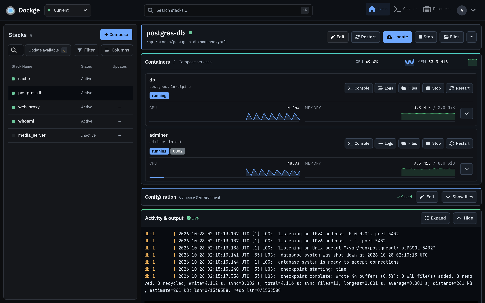
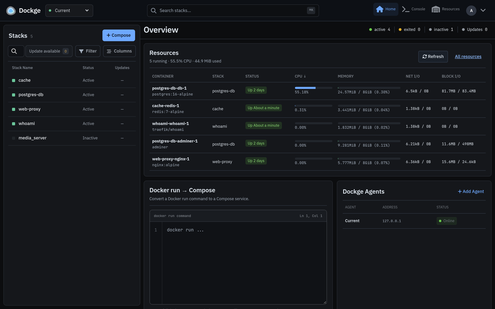
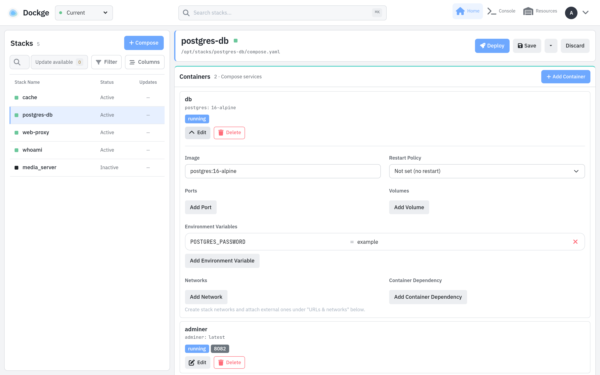
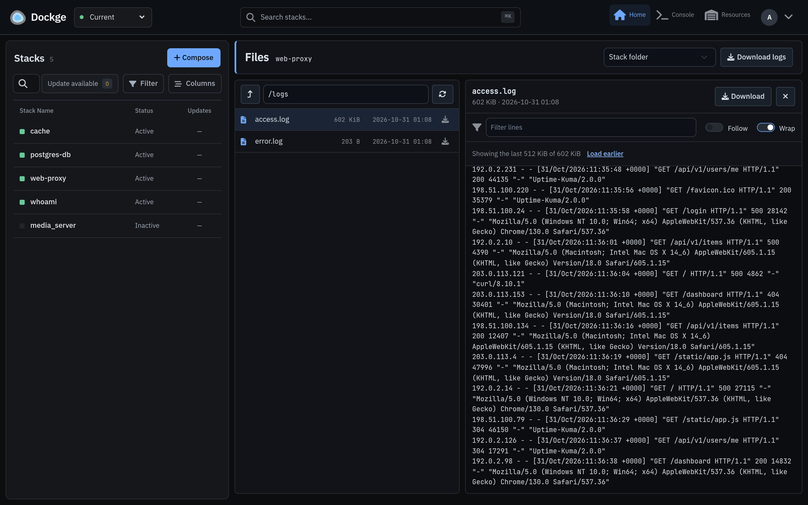
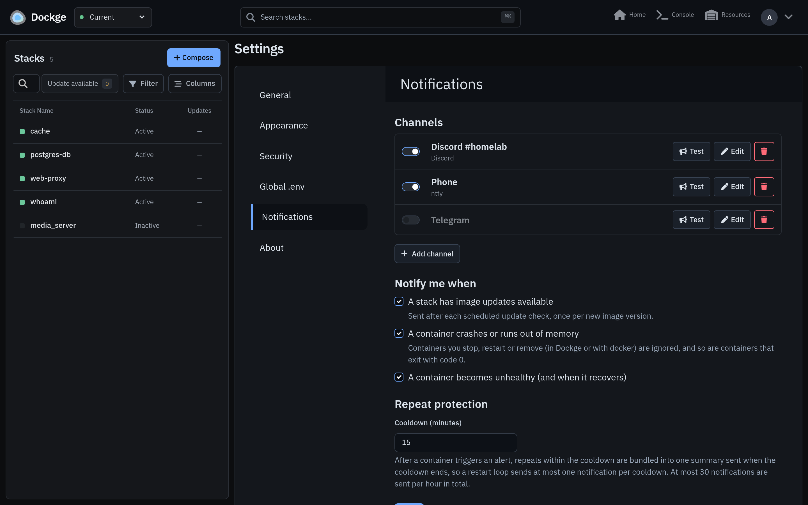
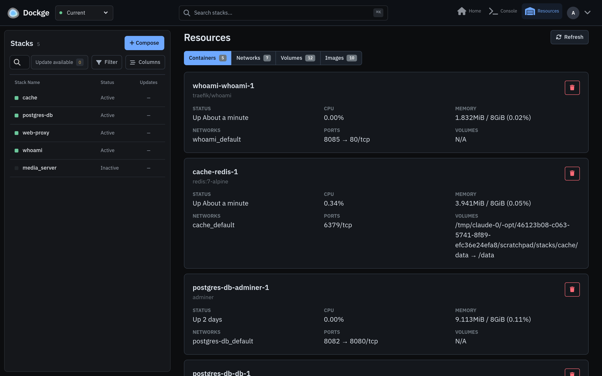
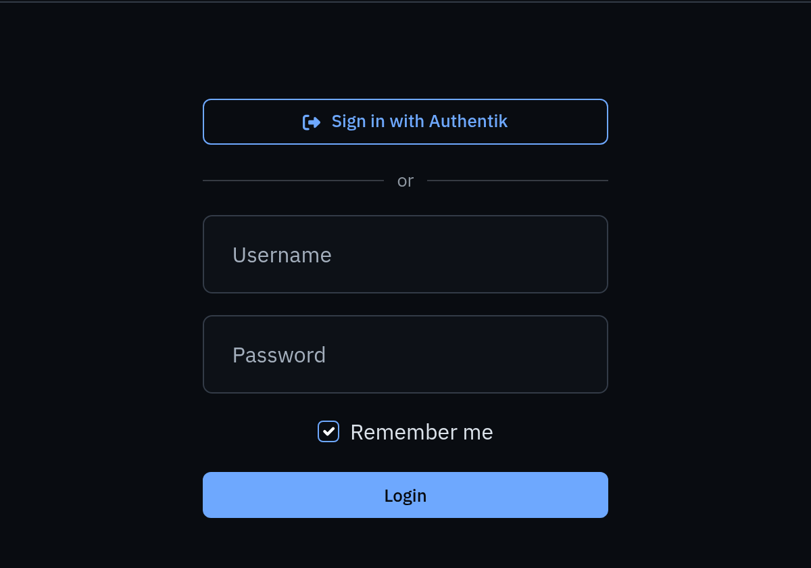
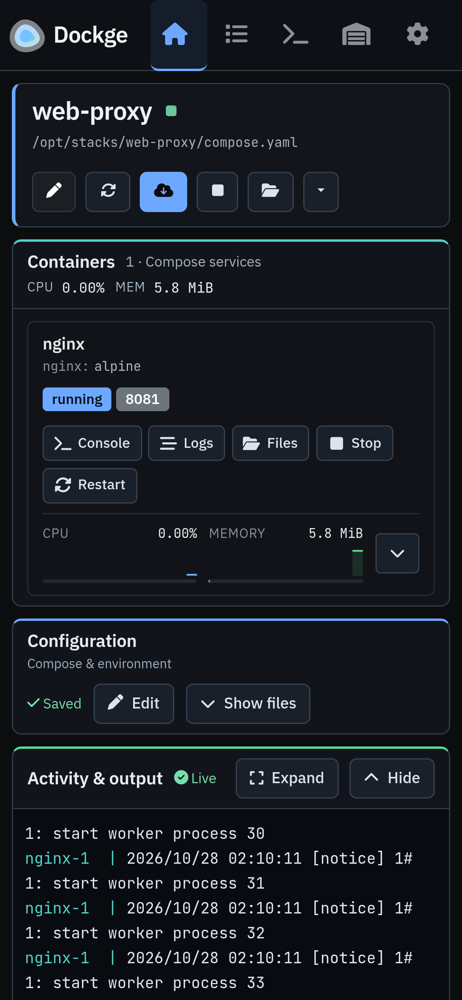

<div align="center">
    
    <h1>Dockge</h1>
    <p>A fast, self-hosted manager for your Docker Compose stacks: edit, deploy, update and monitor them from the browser.</p>

[](https://hub.docker.com/r/krevoit/dockge/tags)
[](https://hub.docker.com/r/krevoit/dockge/tags)
[](https://github.com/krevoit/dockge/commits/next-dev/)
[](LICENSE)

</div>



Your stacks stay plain `compose.yaml` folders on disk. Dockge doesn't lock them into a database, so you can keep using `docker compose` (and git) next to it, and stacks started outside Dockge show up too.

## Features

**Stacks**
- Create and edit `compose.yaml` and `.env` in a code editor, or with a form per service: image, ports, volumes, environment variables, networks, restart policy and dependencies.
- Compose override files, and a global `.env` shared by every stack.
- Paste a `docker run …` command and get a Compose service.
- Deploy, start, stop, restart, update, take down and delete whole stacks or single services, with the output streamed live.

**Monitoring**
- Live CPU and memory per container, with 2-minute graphs and stack totals.
- Live combined logs per stack, logs per container, a shell in any container, and an optional console for running `docker` commands.
- An overview of every running container's CPU, memory, network and disk I/O.

**Updates**
- Checks your registries for new image versions on a schedule (every 6 hours by default) and marks the stacks and services that have one.
- One-click update: pull, recreate, then remove the images the update replaced.
- Private registries work through your mounted Docker credentials.

**Files**
- Browse a stack's folder (including bind mounts like `./config` and `./logs`) or the filesystem of a running container.
- View logs (they open on the newest lines), follow them as they grow, and filter lines.
- Download any file, or a container's logs, with a progress bar. [More](#file-explorer)

**Notifications**
- Discord, Telegram, ntfy, Gotify, Microsoft Teams, Mattermost, Apprise and JSON webhooks.
- Image updates, crashed and out-of-memory containers, unhealthy containers and recoveries, with restart-loop protection. [More](#notifications)

**Docker resources**
- Containers, networks, volumes and images in one place, with unused and dangling resources marked.
- Create networks (bridge, macvlan, ipvlan, overlay, with subnet, gateway and driver options) and connect or disconnect containers.
- Dockge's own container and Docker's built-in networks are protected from deletion.

**More**
- Several Docker hosts in one interface through [remote agents](#remote-agents).
- Single sign-on with OpenID Connect, optionally with password login turned off; Cloudflare Turnstile CAPTCHA; login rate limiting.
- Dark and light themes, a mobile layout and ⌘K stack search.
- Images for amd64 and arm64 (including Raspberry Pi with a 64-bit OS).

## Screenshots

| | |
|---|---|
|  |  |
| **Overview** of every running container | **Form editor**, here in the light theme |
|  |  |
| **File explorer** with a log open | **Notification channels** |
|  |  |
| **Docker resources** | **Single sign-on** |

<p align="center"></p>

## Install

Requirements: Linux on amd64 or arm64 with [Docker Engine](https://docs.docker.com/engine/install/) and the Compose plugin.

```bash
# A folder for your stacks and one for Dockge
mkdir -p /opt/stacks /opt/dockge
cd /opt/dockge

# Get the compose file and start Dockge
curl -fsSL https://raw.githubusercontent.com/krevoit/dockge/next-dev/compose.yaml -o compose.yaml
docker compose up -d
```

Open `http://<your-server>:5001` and create your account.

To keep your stacks somewhere other than `/opt/stacks`, change it in all three places in `compose.yaml`: both sides of the volume and `DOCKGE_STACKS_DIR`. The path must be the same inside and outside the container, otherwise relative bind mounts in your stacks (like `./data`) point to the wrong place.

### Update

```bash
cd /opt/dockge
docker compose pull && docker compose up -d
```

### Forgot your password

```bash
docker exec -it dockge npm run reset-password
```

## Configuration

Settings that apply to the whole server are environment variables in `compose.yaml`; everything else is under **Settings** in the app.

| Variable | Default | Description |
|---|---|---|
| `DOCKGE_STACKS_DIR` | `/opt/stacks` | Where your stacks are. Must match the stacks volume |
| `DOCKGE_PORT` | `5001` | Port to listen on |
| `DOCKGE_HOSTNAME` | all interfaces | Address to listen on |
| `DOCKGE_DATA_DIR` | `./data/` | Database and settings |
| `DOCKGE_ENABLE_CONSOLE` | `false` | `true` enables the console page: a shell in the Dockge container, which controls Docker |
| `DOCKGE_SSL_KEY`, `DOCKGE_SSL_CERT`, `DOCKGE_SSL_KEY_PASSPHRASE` | | Serve HTTPS directly instead of behind a reverse proxy |
| `TURNSTILE_SITE_KEY`, `TURNSTILE_SECRET_KEY` | | Cloudflare Turnstile CAPTCHA on the login page |
| `OIDC_*`, `DISABLE_PASSWORD_LOGIN` | | Single sign-on, see [below](#single-sign-on-oidc) |
| `TZ` | | Time zone for logs |

**Private registries:** mount your Docker credentials, e.g. `- /root/.docker:/root/.docker:ro`, so Dockge can pull from them and check them for updates.

**Reverse proxies** must pass WebSocket connections through (Dockge talks to the browser over socket.io).

## Single Sign-On (OIDC)

Dockge can sign in with any OpenID Connect provider: Authentik, Authelia, Keycloak, Pocket ID, Zitadel, Google, Microsoft Entra ID and others. A successful sign-in logs in as the Dockge user, the account created at setup, whatever its name.

| Variable | Description |
|---|---|
| `OIDC_ISSUER_URL` | Issuer URL, e.g. `https://auth.example.com/application/o/dockge/` (required) |
| `OIDC_CLIENT_ID` | Client ID (required) |
| `OIDC_CLIENT_SECRET` | Client secret. Leave it empty for a public client; PKCE is always used |
| `OIDC_REDIRECT_URI` | The callback URL to register at the provider: `https://<your dockge>/auth/oidc/callback`. Recommended behind a reverse proxy; otherwise it's derived from the request |
| `OIDC_PROVIDER_NAME` | Button label, "Sign in with …" (default `SSO`) |
| `OIDC_SCOPES` | Default `openid profile email` |
| `OIDC_TOKEN_AUTH_METHOD` | `client_secret_basic` (default) or `client_secret_post` |
| `DISABLE_PASSWORD_LOGIN` | `true` turns off username and password login, so only single sign-on works |

- **Anyone your provider lets sign in to this client gets into Dockge**, which means control over Docker on the host. Limit the client to the right users or groups in your provider, for example with an application binding in Authentik or an `authorization_policy` in Authelia.
- `DISABLE_PASSWORD_LOGIN` only takes effect while OIDC is configured correctly, so a typo can't lock you out. Turning it on also ends sessions from earlier password logins. On a fresh install, the first single sign-on creates the account (named after your SSO username) instead of the setup page.
- A Dockge with password login turned off can't be added as a remote agent, because agents sign in with a username and password.

## Notifications

Add one or more channels under **Settings → Notifications**. Each has a test button.

| Channel | What you need |
|---|---|
| Discord | A channel webhook URL |
| Telegram | A bot token (from @BotFather) and a chat ID; optionally a topic ID |
| ntfy | Server URL and topic; an access token for protected topics |
| Gotify | Server URL and an application token |
| Microsoft Teams | A Workflows webhook URL ("Send webhook alerts to a channel") |
| Mattermost | An incoming webhook URL; optionally a channel |
| Apprise | An [Apprise API](https://github.com/caronc/apprise-api) URL, which reaches 100+ more services |
| Webhook | Any URL; receives JSON with `event`, `severity`, `title`, `message`, `stack`, `service`, `container`, `image`, `host` and `timestamp` |

Alerts you can turn on:
- **Image updates:** after each scheduled check, once per new image version.
- **Crashed or out-of-memory containers.** Containers you stop, restart or remove (in Dockge or with `docker`) and containers that exit with code 0 don't count.
- **Unhealthy containers**, and when they recover.

A container stuck in a restart loop sends one alert, then one summary per cooldown period (15 minutes by default) instead of an alert per crash. At most 30 notifications are sent per hour.

## File explorer

Open it with **Files** on a stack or on a running container.

- **Stack folder:** the stack's folder on disk, including relative bind mounts. Symlinks pointing outside the folder are shown but can't be opened.
- **Container:** the filesystem of a running container, including its volumes. Files are read as root inside the container, so log folders owned by other users are readable. This needs `sh` in the container; for images without a shell, use the stack folder or download the container's logs.
- **Viewer:** opens on the end of the file, can load earlier parts, follow a growing log (it starts over if the log is rotated), filter lines and wrap long lines. Colour codes are stripped and binary files are detected.
- **Downloads:** any file, or the logs of one container or the whole stack (`docker compose logs` with timestamps). Downloads also work through remote agents.

The explorer is read-only: it doesn't upload, edit or delete files.

## Remote agents

To manage stacks on other Docker hosts, install Dockge on each of them, then open **Overview → Dockge Agents → Add Agent** on the one you use. Enter the other instance's URL and its username and password. Its stacks then appear in the same list, grouped by host.

- Password login must stay enabled on the agents.
- Only enable the Turnstile CAPTCHA on the instance you log in to; agents can't solve it.

## Security

Anyone who can sign in to Dockge controls Docker, which means root on the host. Keep it on a private network or behind a reverse proxy with HTTPS, and use single sign-on or the CAPTCHA if it's reachable from the internet.

What Dockge does to keep that boundary tight:

- **Input checks:** stack names, service names and file paths are validated before they reach the filesystem or Docker. User input goes to `docker` as separate arguments (after `--` where it could look like an option), never through a shell. Paths can't leave the stacks folder or a stack's folder, through `..` or symlinks.
- **Logins:** login attempts are rate limited and the CAPTCHA is optional. Sessions expire after 30 days and end when the password changes. Single sign-on uses PKCE, binds each login to the browser that started it, and never puts session tokens in URLs.
- **Browser:** a strict Content Security Policy and headers against clickjacking and MIME sniffing.
- **Image:** built on Node.js 24 LTS and Debian 13 with only what Dockge needs: no compilers, curl or gnupg. Every build is scanned with Trivy and smoke-tested on amd64 and arm64 before `latest` moves.

Found a vulnerability? Please report it privately, see [SECURITY.md](SECURITY.md).

## Images

| Tag | Architectures | |
|---|---|---|
| `latest` | amd64, arm64 | Current version, built from the `next-dev` branch |
| `next-dev` | amd64, arm64 | Same as `latest` |
| `<commit sha>` | amd64, arm64 | A specific build, to pin a version |

Published as [`krevoit/dockge`](https://hub.docker.com/r/krevoit/dockge) on Docker Hub and as `ghcr.io/krevoit/dockge`. There's no 32-bit ARM image, because Node.js 24 has no official one.

## Development

See [CONTRIBUTING.md](CONTRIBUTING.md).

## License

[MIT](LICENSE). Based on [Dockge](https://github.com/louislam/dockge) by Louis Lam.
